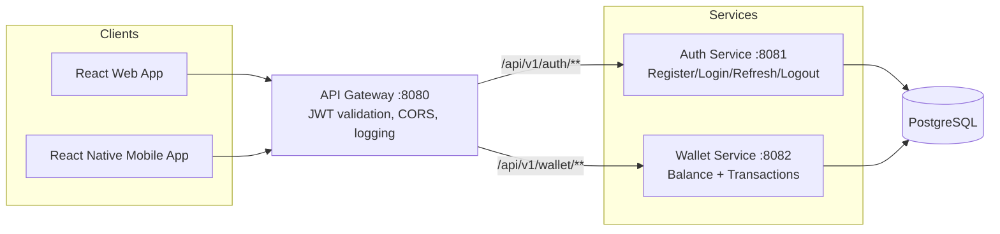

# Digital Wallet

A learning-focused digital wallet system, built incrementally across 13 phases, covering a Java/Spring Boot microservices backend, a React web app, and a React Native mobile app.

## What is a Digital Wallet?

A digital wallet lets users:
- **Top up** money from a bank card
- **Pay** at e-commerce sites using wallet balance
- **Transfer** money to another user's wallet

## Current Status: Phase 4 complete (v0.4.0)

| Phase | Feature | Status |
|---|---|---|
| 1 | Auth service foundation + React login | ✅ Done |
| 2 | JWT auth + refresh tokens + wallet DB | ✅ Done |
| 3 | Wallet Service (balance + transaction history) | ✅ Done |
| 4 | API Gateway (single entry point, JWT validation, CORS) | ✅ Done |
| 5–13 | Ledger, mock/Stripe payments, Eureka, RabbitMQ, transfers, resilience, mobile polish, prod readiness | 🔜 Pending |

See [`.cursor/.plans/digital_wallet_implementation.plan.md`](.cursor/.plans/digital_wallet_implementation.plan.md) for the full phase plan and [`CHANGELOG.md`](CHANGELOG.md) for release history.

## Architecture (current)

All client traffic goes through a single **API Gateway**; backend services share one PostgreSQL database.



The longer-term target architecture (Ledger service, event bus, PSP integration, risk engine) is documented in [`docs/architecture.md`](docs/architecture.md) and [`docs/system-design.md`](docs/system-design.md) — those reflect the **end-state design**, not what's built yet.

## Repository Layout

```
.
├── backend/            Java 17 / Spring Boot microservices
│   ├── api-gateway/    Spring Cloud Gateway — port 8080
│   ├── auth-service/   Auth, JWT, wallet creation — port 8081
│   └── wallet-service/ Balance + transaction history — port 8082
├── frontend/           React + TypeScript web app (Vite)
├── mobile/             React Native app (iOS + Android)
├── packages/
│   └── shared-theme/   Shared CSS theme tokens for web
├── docs/               Architecture & system design references
└── .cursor/            Rules, skills, and implementation plans (see below)
```

## Getting Started

Each surface has its own detailed README:

| Surface | README | Quick start |
|---|---|---|
| Backend | [`backend/README.md`](backend/README.md) | `docker compose up -d` → run each service with `mvn spring-boot:run` |
| Web | [`frontend/readme.md`](frontend/readme.md) | `cd frontend && npm install && npm run dev` |
| Mobile | [`mobile/README.md`](mobile/README.md) | `cd mobile && npm start`, then `npm run ios` / `npm run android` |

**Ports:** Gateway `8080` (client entry) · Auth `8081` · Wallet `8082` · Metro `8088` · Web dev server `5173`.

## Tech Stack

- **Backend:** Java 17, Spring Boot, Spring Security (JWT), Spring Cloud Gateway, PostgreSQL, Flyway, Maven
- **Web:** React, TypeScript, Vite
- **Mobile:** React Native, TypeScript, React Navigation, react-native-keychain
- **Shared:** `packages/shared-theme` (CSS tokens used by the web app)

## Cursor Rules & Skills (Project Workflows)

This repo ships three project-specific Cursor **Skills**, each backed by an always-applied rule that routes trigger phrases to it. They act as repeatable review/release "agents" tailored to this codebase (JWT auth, wallet money paths, multi-surface structure).

| Skill | Rule | Triggers | What it does |
|---|---|---|---|
| **Code Review Companion** | `.cursor/rules/code-review-companion.mdc` | "code review", "PR review", "review diff", "review this branch" | Structured 5-pillar review (correctness, tests, style, architecture, security) of a diff/branch/PR, scoped by `backend/frontend/mobile/packages` and project conventions in `.cursor/.rules/`. Read-only by default; emits a severity-rated findings report. |
| **Security Scan Companion** | `.cursor/rules/security-scan-companion.mdc` | "security scan", "JWT security review", "Keychain scan", "secrets scan", "money path security", "idempotency review", "CORS scan" | Deep, six-area security pass: JWT/auth tokens, Keychain/secure storage, secrets, money paths, idempotency, CORS. Defaults to diff/branch scope; "full scan" covers the whole repo. Read-only unless fixes are requested. |
| **Docs-Release Companion** | `.cursor/rules/docs-release-companion.mdc` | "docs from code", "sync docs", "release notes", "changelog", "prepare release docs" | Compares READMEs against code to find drift, and drafts `CHANGELOG.md` / release notes from a git range. Always drafts in chat first — writes files only after explicit "apply docs" / "apply changelog" / "apply all". |

Each skill is **opt-in** (`disable-model-invocation: true`) — it runs only when you ask for it by name or trigger phrase, and the three don't auto-invoke each other or generic Cursor Bugbot/Security Review unless you ask.

Supporting convention docs these skills read from (not standalone workflows): `.cursor/.rules/backend.md`, `frontend.md`, `mobile.md`, `mobile-ios-dev.md`, `mobile-android-dev.md`, `storage.md`, `interservice-communication.md`, `development-practices.md`.
