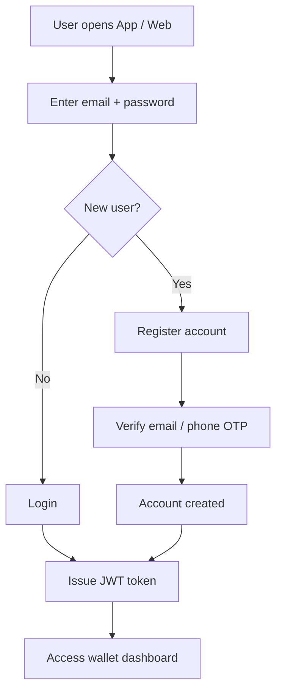
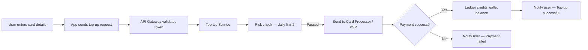
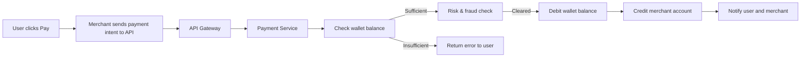
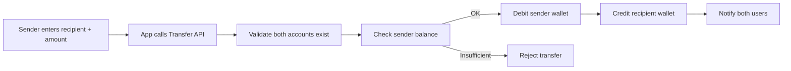
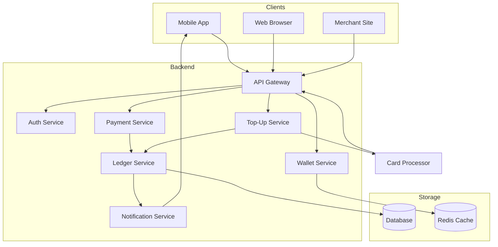

# Digital Wallet — System Design

---

## 1. What is a Digital Wallet?

A digital wallet lets users:

- **Top up** money from a bank card
- **Pay** at e-commerce sites using wallet balance
- **Transfer** money to another user's wallet

---

## 2. User Registration & Login

Before doing anything, the user signs up and logs in.

**Key points:**

- OTP verifies the user owns the phone/email
- A JWT token is issued after login — every API call carries this token
- Token expires (e.g. 15 min) and is refreshed silently

---

## 3. Top-Up — Adding Money to the Wallet

The user adds money from their bank card into the wallet.

**Key points:**

- The card processor (e.g. Stripe) charges the card
- Only after a success webhook from PSP does the balance update
- The ledger records a debit from "bank" and credit to "wallet" (double-entry)

---

## 4. Making a Payment

The user pays for something on an e-commerce site using wallet balance.

**Key points:**

- Balance check and debit happen atomically (no partial updates)
- Both debit and credit are written together in the ledger
- Merchant gets notified via webhook

---

## 5. Wallet-to-Wallet Transfer

Sending money to another user on the same platform (like PayPal P2P).

**Key points:**

- This is faster than bank transfers — happens instantly within the platform
- No external PSP needed
- Both debit and credit must succeed together (atomic transaction)

---

## 6. High-Level System Overview

How all the pieces fit together on the backend.

---

## 7. Key Design Decisions

| Concern             | Approach                                             |
| ------------------- | ---------------------------------------------------- |
| **Consistency**     | ACID database for all money movements                |
| **No double spend** | Atomic debit + credit in one transaction             |
| **Idempotency**     | Each request has a unique ID — retries are safe      |
| **Security**        | JWT auth on every request, OTP for sensitive actions |
| **Speed**           | Redis caches wallet balance for fast reads           |
| **Notifications**   | Async via event bus — doesn't block the transaction  |

